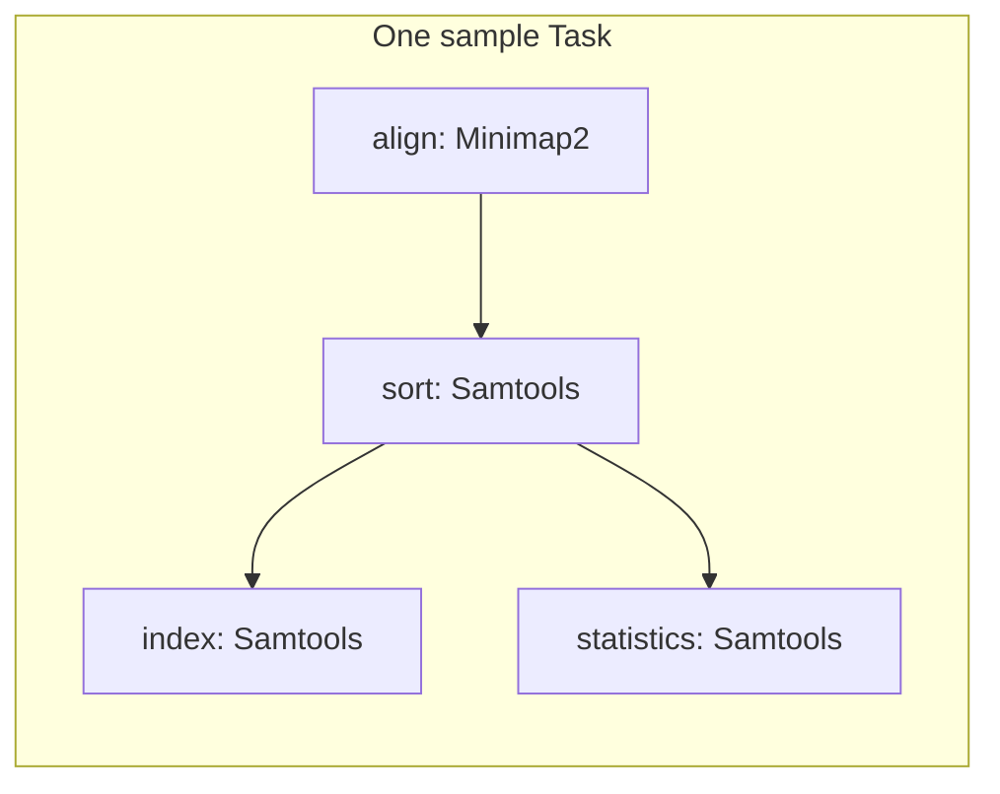
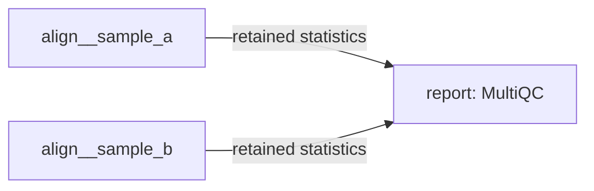

# Synthetic read alignment

This workflow aligns two small samples against an artificial reference sequence.
A read is a short DNA sequence. Paired reads represent opposite ends of one
DNA fragment. The workflow retains each sample's alignment and statistics, then
combines the statistics into a MultiQC report.

All input data is included in [data/](data/). The workflow uses public container
images built from Bioconda packages. The only downloads required for a run are
the container images on first use.

## Tasks and computation targets

A Task groups computation targets and names the outputs to retain.
Each sample uses the same Task implementation with a different instance key.
Inside each sample Task, four targets form this graph:



The `align` target produces a SAM file, a text alignment format.
The `sort` target produces a BAM file, a compressed alignment format.
The index supports access to parts of the BAM file.
The statistics count mapped reads and paired reads.

The Task reaches Completion after every target succeeds and its retained files
are installed. Cleanup can then remove its SAM file and other private work.
Reuse accepts the completed Task even when those internal intermediates are gone.

The two sample Tasks run independently. The report Task consumes their named
retained statistics and waits for both producers to complete:



| Task | Retained files under `results/` | Disposable work |
| --- | --- | --- |
| `align__sample_a` | `sample_a/alignment.bam`, `sample_a/alignment.bam.bai`, `sample_a/flagstat.txt` | SAM file and temporary files |
| `align__sample_b` | `sample_b/alignment.bam`, `sample_b/alignment.bam.bai`, `sample_b/flagstat.txt` | SAM file and temporary files |
| `report` | `report/report.html`, `report/summary.tsv` | Other report-building files |

[workflow.py](workflow.py) declares the samples and connects their retained outputs.
[task_library.py](task_library.py) defines the reusable Tasks, commands, and images.
[multiqc_config.yaml](multiqc_config.yaml) displays individual reads instead of millions
of reads. The report Task declares this configuration file as an external input.
Files passed between Tasks are retained outputs. Internal intermediates stay
inside their owning Task.

## Run locally

Use Linux x86_64, Bash, and Apptainer on `PATH`.
Install gwflow with the [root installation instructions](../README.md#install).
Enter this checkout's `example/` directory in the first terminal:

```sh
cd example
gwflow config set backend local
```

In a second terminal, activate the same environment and enter the same
`example/` directory. Start two workers:

```sh
conda activate gwflow
gwflow workers -n 2
```

Leave the workers running. In the first terminal, preview and run only the
sample Tasks:

```sh
gwflow run 'align__*' --dry-run
gwflow run 'align__*'
gwflow wait 'align__*' --interval 1
gwflow status 'align__*' --static
```

The first preview acquires the missing Minimap2 and Samtools images.
Submission returns before computation finishes. The `wait` command observes
the submitted Tasks until they complete or need another action.
Continue when both sample Tasks are `reusable`.

Inspect the statistics and preview cleanup:

```sh
cat results/sample_a/flagstat.txt
cat results/sample_b/flagstat.txt
gwflow clean 'align__*'
```

Delete eligible work, then inspect the retained statistics again:

```sh
gwflow clean 'align__*' --delete
cat results/sample_a/flagstat.txt
cat results/sample_b/flagstat.txt
```

Cleanup removes the internal SAM files and other private work.
The BAM files, indexes, and statistics remain under `results/`.
Now run the report Task from the retained statistics:

```sh
gwflow run report --dry-run
gwflow run report
gwflow wait report --interval 1
cat results/report/summary.tsv
```

The preview acquires the MultiQC image if it is missing.
It shows Reuse for `align__sample_a` and `align__sample_b`, and Run for `report`.
Only the report Task computes. It does not need either producer's internal SAM file.
Open `results/report/report.html` in a browser to compare the samples.

An unchanged run submits no new jobs:

```sh
gwflow run --dry-run
gwflow run
```

From a fresh checkout, `gwflow run` also runs all three Tasks with their dependencies.
Use `gwflow wait --interval 1` to wait for that complete workflow.
Stop the local workers with Ctrl-C when finished.

## Inspect and rerun

Use the Task name to inspect all jobs within that Task.
Use the public job name to read a particular computation target's log.
For example, `align__sample_a__align` is the alignment target in the first sample Task:

```sh
gwflow status align__sample_a --details
gwflow logs align__sample_a
gwflow logs align__sample_a__align --stderr --no-pager
gwflow run report --dry-run --details
```

Changes to a command or a tracked input require a fresh Task attempt.
To request one explicitly, run `gwflow run align__sample_a --force`.
After that Task completes, run `gwflow run report` to update the report.
The unchanged second sample remains reusable.

Keep `results/` and `.gwf/` together. Cleanup preserves the records needed for
Reuse, but removes sources used for repair. If retained results become invalid
after cleanup, their Task must compute again.

For Slurm, select the site's backend and resources as described in the
[reference](../docs/reference.md#executable-discovery-and-backends).
The environment, workflow files, results, and image cache must be accessible
at the same paths on the frontend and compute nodes. Slurm does not need the local worker process.

## Synthetic data

The dataset contains a 10,000-base artificial reference and 100 read pairs per sample.
Each read has 150 bases. The two reads come from a 350-base fragment.
There are no real biological sequences or sequencing errors in these inputs.

All fragments in `sample_a` come from the reference.
In `sample_b`, 20 fragments come from unrelated artificial sequences.
Those fragments have no exact 15-base match on either reference strand.
The expected statistics are:

| Sample | Read pairs | Total primary reads | Mapped reads | Unmapped reads | Mapped percentage |
| --- | ---: | ---: | ---: | ---: | ---: |
| `sample_a` | 100 | 200 | 200 | 0 | 100% |
| `sample_b` | 100 | 200 | 160 | 40 | 80% |

[expected.json](data/expected.json) records the expected counts and generation parameters.
[truth.tsv](data/truth.tsv) records each fragment's source coordinates.
Its coordinates start at one and include both endpoints. An asterisk marks an unmapped pair.

The dataset occupies about 150 kB. All inputs are ready to run from the checkout.
The optional [generator](generate_data.py) uses only Python's standard library and
the fixed seed `20261103`. From the repository root, regenerate a separate copy with:

```sh
python example/generate_data.py --output-dir build/synthetic-example-data
diff -r example/data build/synthetic-example-data
```

## Container images

Bioconda publishes these images through the BioContainers namespace on Quay.
The executable `docker://` references in [task_library.py](task_library.py)
pin image digests. These tags identify the corresponding package builds:

| Tool | Published image and build | Purpose |
| --- | --- | --- |
| [Minimap2](https://bioconda.github.io/recipes/minimap2/README.html#container) | `quay.io/biocontainers/minimap2:2.28--h577a1d6_4` | Align paired reads |
| [Samtools](https://bioconda.github.io/recipes/samtools/README.html#container) | `quay.io/biocontainers/samtools:1.21--h96c455f_1` | Sort, index, and count alignments |
| [MultiQC](https://bioconda.github.io/recipes/multiqc/README.html#container) | `quay.io/biocontainers/multiqc:1.25.2--pyhdfd78af_0` | Combine both samples' statistics |

Apptainer acquires and executes these Docker-format images. A Docker daemon and
local image builds are not required. Host Python needs gwflow, but the images
only need their own commands and Bash.

Run previews, runs, and status can acquire missing images.
gwflow stores acquired images in `~/.cache/gwflow/images` by default.
Set `GWFLOW_IMAGE_CACHE` to select another cache directory. For Slurm, use a cache
at the same shared path on the frontend and compute nodes.

Keep the cache outside `work/`, `results/`, and `.gwf/`.
Work cleanup never deletes cached images. Later runs reuse them without a
registry download. See the [container reference](../docs/reference.md#containers)
for image dependencies, acquisition failures, and cache behavior.
