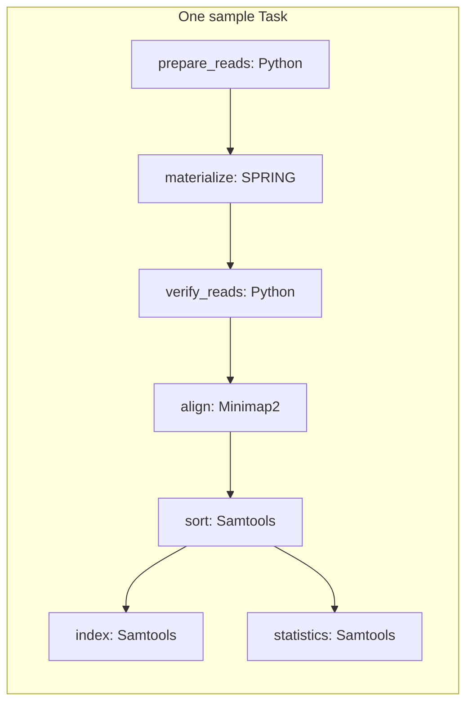
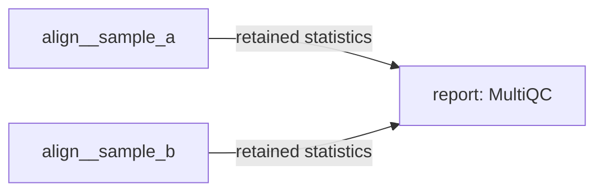

# Synthetic read alignment

This workflow aligns two small samples against an artificial reference sequence.
A read is a short DNA sequence. Paired reads represent opposite ends of one
DNA fragment. The workflow retains each sample's alignment and statistics, then
combines the statistics into a MultiQC report.

All input data is included in [data/](data/). The workflow uses containers for every computation target.
Every target uses a public Python or Bioconda image.
Container images are downloaded on first use.

## Tasks and computation targets

A Task groups computation targets and names the outputs to retain.
Each sample uses the same Task implementation with a different instance key.
Inside each sample Task, seven targets form this graph:



Each sample has one logical input named `reads`. Its identity contains
the SHA-256 checksum for each FASTQ mate. The [sample manifest](data/reads.json)
records these checksums and selects the input format for each sample.
The [read helper](materialize_reads.py) runs in the public Python image.
The `prepare_reads` target bundles the selected files into `reads.tar` with fixed names.
The `materialize` target runs in the public SPRING image. It extracts FASTQs directly
or decodes `input.spring` into paired FASTQs.
The `verify_reads` target checks both mates against their declared checksums.
Alignment waits for this check to succeed.

All three targets run for both formats. Their declarations stay stable so an
equivalent archive can replace the original FASTQs without invalidating completed work.
The extra bundle favors a simple example over efficient copying.
The reference and the script are ordinary tracked inputs.

The `align` target reads the private `R1.fastq` and `R2.fastq` files and produces a SAM file, a text alignment format.
The `sort` target produces a BAM file, a compressed alignment format.
The index supports access to parts of the BAM file.
The statistics count mapped reads and paired reads.

The Task reaches Completion after every target succeeds and its retained files
are installed. Cleanup can then remove its SAM file and other private work.
Reuse accepts the completed Task even when those internal intermediates are gone.

The two sample Tasks run independently. The report Task consumes their named
retained statistics and waits for both producers to complete:



| Task | Retained files under `results/` | Disposable work |
| --- | --- | --- |
| `align__sample_a` | `sample_a/alignment.bam`, `sample_a/alignment.bam.bai`, `sample_a/flagstat.txt` | Materialized FASTQs, SAM file, and temporary files |
| `align__sample_b` | `sample_b/alignment.bam`, `sample_b/alignment.bam.bai`, `sample_b/flagstat.txt` | Materialized FASTQs, SAM file, and temporary files |
| `report` | `report/report.html`, `report/summary.tsv` | Other report-building files |

[workflow.py](workflow.py) declares the samples and connects their retained outputs.
[task_library.py](task_library.py) defines the reusable Tasks, commands, and images.
[multiqc_config.yaml](multiqc_config.yaml) displays individual reads instead of millions
of reads. The report Task declares this configuration file as an external input.
Files passed between Tasks are retained outputs. Internal intermediates stay
inside their owning Task.

## Run locally

Use Linux x86_64, Bash, Python 3.12, exactly gwf 3.0.0, and Apptainer 1.5.4 on `PATH`.
Install gwflow with the [root installation instructions](../README.md#install).
From the checkout root, copy the example to a fresh working directory.
The optional archive walkthrough moves files in this copy.

```sh
demo=$(mktemp -d)
cp -r example/*.py example/*.yaml example/data "$demo/"
cd "$demo"
gwflow config set backend local
pwd
```

The host and workers do not need a separate SPRING installation or local image builds.

In a second terminal, enter the directory printed by `pwd`.
Activate the same gwflow environment.
Start the local scheduler with a two-core budget.

```sh
conda activate gwflow
gwflow workers -n 2 --max-memory 4g
```

Leave the scheduler running. Each alignment requests two cores, so only one
alignment runs at a time with this budget. Other jobs reserve their declared
cores and memory. Reservations do not enforce actual CPU or memory use.
Other workflow directories have independent budgets. See the
[resource reference](../docs/reference.md#local-resources-and-walltime) before
running several schedulers on one machine.

In the first terminal, preview and run only the sample Tasks:

```sh
gwflow run 'align__*' --dry-run
gwflow run 'align__*'
gwflow wait 'align__*' --interval 1
gwflow status 'align__*' --static
```

The first preview acquires the missing Python, SPRING, Minimap2, and Samtools images.
Submission returns before computation finishes. The `wait` command observes
the submitted Tasks until they complete or need another action.
Continue when both sample Tasks are `reusable`.

Inspect the statistics and preview cleanup:

```sh
cat results/sample_a/flagstat.txt
cat results/sample_b/flagstat.txt
gwflow clean 'align__*'
```

Delete eligible work, then inspect the retained statistics again:

```sh
gwflow clean 'align__*' --delete
cat results/sample_a/flagstat.txt
cat results/sample_b/flagstat.txt
```

Cleanup removes the internal SAM files and other private work.
The BAM files, indexes, and statistics remain under `results/`.
Now run the report Task from the retained statistics:

```sh
gwflow run report --dry-run
gwflow run report
gwflow wait report --interval 1
cat results/report/summary.tsv
```

The preview acquires the MultiQC image if it is missing.
It shows Reuse for `align__sample_a` and `align__sample_b`, and Run for `report`.
Only the report Task computes. It does not need either producer's internal SAM file.
Open `results/report/report.html` in a browser to compare the samples.

An unchanged run submits no new jobs:

```sh
gwflow run --dry-run
gwflow run
```

From a fresh checkout, `gwflow run` also runs all three Tasks with their dependencies.
Use `gwflow wait --interval 1` to wait for that complete workflow.
Stop the local workers with Ctrl-C when finished.

## Archive one sample with SPRING

Complete both alignments and the report in the working copy above. Keep the workers running.
Record the attempt ID for `align__sample_a`. Clean its private work so only its retained results and lifecycle records remain.

```sh
gwflow status align__sample_a --details --static
gwflow clean align__sample_a --delete
```

Use SPRING's default lossless paired-end mode. It preserves read order, identifiers, sequences, and quality scores.
Restore both mates and compare them byte for byte with the FASTQs that the first run verified.
Move the originals outside the workflow only after both comparisons succeed.

```sh
saved=$(mktemp -d)
spring_image=$(python -c 'from task_library import SPRING; print(SPRING)')
apptainer exec --cleanenv --bind "$PWD" --pwd "$PWD" "$spring_image" \
  spring -c -t 1 -i data/sample_a_R1.fastq data/sample_a_R2.fastq -o data/sample_a.spring &&
  apptainer exec --cleanenv --bind "$PWD" --bind "$saved" --pwd "$PWD" "$spring_image" \
    spring -d -t 1 -i data/sample_a.spring -o "$saved/restored_R1.fastq" "$saved/restored_R2.fastq" &&
  cmp data/sample_a_R1.fastq "$saved/restored_R1.fastq" &&
  cmp data/sample_a_R2.fastq "$saved/restored_R2.fastq" &&
  mv data/sample_a_R1.fastq data/sample_a_R2.fastq "$saved/"
```

In `data/reads.json`, change the `format` for `sample_a` from `fastq` to `spring`.
Keep the two checksums and the `sample_b` entry as they are.
gwflow trusts the declared identity when it reuses a completed Task. The round trip above establishes that the archive contains the same reads.

```sh
gwflow run --dry-run
gwflow run
gwflow status align__sample_a --details --static
```

The preview shows `Reuse` for both sample Tasks and `report`.
The run submits zero jobs. The attempt ID for `align__sample_a` matches the one you recorded.

To exercise the archive decoder, force a fresh attempt for the archived sample.

```sh
gwflow run align__sample_a --force
gwflow wait align__sample_a --interval 1
gwflow logs align__sample_a__verify_reads --no-pager
gwflow status align__sample_a --details --static
cat results/sample_a/flagstat.txt
```

The log shows `Verified both FASTQ mates from spring`. The attempt ID changes,
and the statistics still show 200 mapped reads. A later `gwflow run report`
updates the report for the new producer attempt.

## Inspect and rerun

Use the Task name to inspect all jobs within that Task.
Use the public job name to read a particular computation target's log.
For example, `align__sample_a__align` is the alignment target in the first sample Task:

```sh
gwflow status align__sample_a --details
gwflow logs align__sample_a
gwflow logs align__sample_a__align --stderr --no-pager
gwflow run report --dry-run --details
```

Changes to a command or a tracked input require a fresh Task attempt.
To request one explicitly, run `gwflow run align__sample_a --force`.
After that Task completes, run `gwflow run report` to update the report.
The unchanged second sample remains reusable.

Keep `results/` and `.gwf/` together. Cleanup preserves the records needed for
Reuse, but removes sources used for repair. If retained results become invalid
after cleanup, their Task must compute again.

For Slurm, select the site's backend and resources as described in the
[reference](../docs/reference.md#executable-discovery-and-backends).
The environment, workflow files, results, and image cache must be accessible
at the same paths on the frontend and compute nodes. Slurm does not need the local worker process.

## Synthetic data

The dataset contains a 10,000-base artificial reference and 100 read pairs per sample.
Each read has 150 bases. The two reads come from a 350-base fragment.
There are no real biological sequences or sequencing errors in these inputs.

All fragments in `sample_a` come from the reference.
In `sample_b`, 20 fragments come from unrelated artificial sequences.
Those fragments have no exact 15-base match on either reference strand.
The expected statistics are:

| Sample | Read pairs | Total primary reads | Mapped reads | Unmapped reads | Mapped percentage |
| --- | ---: | ---: | ---: | ---: | ---: |
| `sample_a` | 100 | 200 | 200 | 0 | 100% |
| `sample_b` | 100 | 200 | 160 | 40 | 80% |

[expected.json](data/expected.json) records the expected counts and generation parameters.
[truth.tsv](data/truth.tsv) records each fragment's source coordinates.
Its coordinates start at one and include both endpoints. An asterisk marks an unmapped pair.

The dataset occupies about 150 kB. All inputs are ready to run from the checkout.
The optional [generator](generate_data.py) uses only Python's standard library and
the fixed seed `20261103`. From the repository root, regenerate a separate copy with:

```sh
python example/generate_data.py --output-dir build/synthetic-example-data
diff -r example/data build/synthetic-example-data
```

## Container images

All targets use public images. The Python image comes from Docker Hub.
Bioconda publishes the other images through the BioContainers namespace on Quay.
No local image build is required. The same images serve both input formats.

The executable `docker://` references in [task_library.py](task_library.py)
pin image digests. These tags identify the corresponding package builds:

| Tool | Published image and build | Purpose |
| --- | --- | --- |
| Python | `docker.io/library/python` (digest pinned in `task_library.py`) | Prepare files and verify checksums |
| [SPRING](https://bioconda.github.io/recipes/spring/README.html#container) | `quay.io/biocontainers/spring:1.1.1--h4ac6f70_3` | Materialize paired reads |
| [Minimap2](https://bioconda.github.io/recipes/minimap2/README.html#container) | `quay.io/biocontainers/minimap2:2.28--h577a1d6_4` | Align paired reads |
| [Samtools](https://bioconda.github.io/recipes/samtools/README.html#container) | `quay.io/biocontainers/samtools:1.21--h96c455f_1` | Sort, index, and count alignments |
| [MultiQC](https://bioconda.github.io/recipes/multiqc/README.html#container) | `quay.io/biocontainers/multiqc:1.25.2--pyhdfd78af_0` | Combine both samples' statistics |

Apptainer acquires and executes these Docker-format images without a Docker daemon.
Host Python needs gwflow. Each image supplies its own commands and Bash.

Run previews, runs, and status can acquire missing images.
gwflow stores acquired images in `~/.cache/gwflow/images` by default.
Set `GWFLOW_IMAGE_CACHE` to select another cache directory. For Slurm, use a cache
at the same shared path on the frontend and compute nodes.

Keep the cache outside `work/`, `results/`, and `.gwf/`.
Work cleanup never deletes cached images. Later runs reuse them without a
registry download. See the [container reference](../docs/reference.md#containers)
for image dependencies, acquisition failures, and cache behavior.
